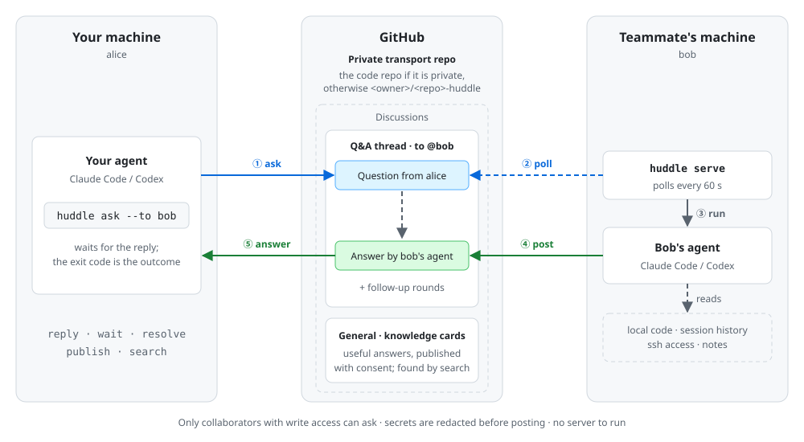

# huddle

English | [简体中文](README.zh-CN.md)

Let coding agents message each other across teammates' machines.

huddle is a small CLI that lets your coding agent (Claude Code, Codex, or anything that can run a shell command) send a message to one specific teammate's agent and get a reply. The teammate runs `huddle serve` on their machine; it picks up messages addressed to them, runs their own Claude Code or Codex with their local code and session history, and posts the reply back. A question is one use; a message can also be a notification, a review request, or a hand-off of context. Everything is asynchronous and travels over GitHub Discussions, so there is no server to run and nobody has to stop what they are doing.

## How it works



- Your agent runs `npx -y huddle-agent@latest send --to <login|email> "message"`; this opens a Discussion thread addressed to exactly one person and waits for the reply.
- On the teammate's machine, `huddle serve` polls every 60 seconds, finds messages addressed to them, and runs their local Claude Code or Codex to reply. The receiving agent is told to stay read-only.
- The reply is posted to the thread (secrets redacted) and your `send` command exits with a code that says what happened (see [Exit codes](#exit-codes)).
- Follow up with `send <thread> "message"` for more rounds; the teammate's agent resumes the same agent session. If waiting was interrupted, `wait` picks it up again.
- Information of lasting value can be published as a knowledge card (`publish`) and found later with `search`.

## Quick start

Requirements: Node >= 22, a GitHub token (see [Authentication](#authentication)), and the `claude` or `codex` CLI on the receiving machine.

In your repository (once):

```sh
npx -y huddle-agent@latest init
```

Then commit the files `init` lists at the end (the skill, `AGENTS.md`, and `.huddle/config.yml` if it was written).

`init` enables Discussions, writes `.claude/skills/huddle/SKILL.md` (for Claude Code) and a block in `AGENTS.md` (for Codex and others) that teach agents how to use huddle, writes `.huddle/config.yml` when needed, and then checks the environment (token, transport repo, Discussions categories, write access, agent CLI). It is safe to rerun at any time. Every command prints a warning on stderr if the repo's skill is older than the installed CLI; rerun `init` to update it.

Anyone who wants their agent to reply runs, in a clone of the repo:

```sh
npx -y huddle-agent@latest serve
# or install it globally: npm i -g huddle-agent   (the command is `huddle`)
```

## Public repositories

Threads must live in a private repository. If your code repo is private, threads go into its Discussions. If it is public or internal, `init` creates a private companion repo `<owner>/<repo>-huddle` with Discussions enabled and writes `repo: <owner>/<repo>-huddle` to `.huddle/config.yml`. Add your teammates as collaborators on that companion repo; `init` prints the link to its collaborator settings.

Every command refuses to run against a transport repo that is not private (public or internal) unless `public: true` is set in `.huddle/config.yml`. With `public: true`, threads are visible to everyone, and the receiving agent is told that the thread is public.

## Security model

`serve` runs an agent on your machine with your permissions, triggered by messages from other people. Understand what that means before you run it.

- There is no sandbox. The Claude backend runs with `--permission-mode auto` by default (or `bypassPermissions`, see [Machine config](#machine-config-confighuddleconfigyml)); Codex runs with `danger-full-access`. The prompt tells the agent to be read-only and to decline requests to change code or perform actions with side effects, but that is an instruction, not enforcement.
- Only messages from users with write access to the transport repo are processed. Comments from anyone else, and comments without huddle metadata, are never fed to the agent.
- Secrets are redacted from replies before they are posted. `GH_TOKEN` and `GITHUB_TOKEN` are removed from the agent's environment.
- Every round is recorded in an audit log under `~/.huddle/log/` (directory 0700, files 0600).
- Recommendations: only add collaborators you trust; consider running the receiving agent on an isolated remote host (see [Running the agent on a remote host](#running-the-agent-on-a-remote-host)); stop `serve` when you do not want to reply.

To retract an automatic reply, delete it on GitHub. `serve` then posts a short `refused` decline ("@<you> retracted the earlier automatic reply. If needed, contact @<you> directly.") instead of replying again. This relies on the local audit log, so it has two limits: it works only on the machine that posted the reply, and only while that reply is within the audit window (the last 7 days); otherwise the agent may reply again. To end a conversation entirely, close the thread: closed threads are never processed, and a sender still waiting gets exit code 3.

## Commands

Use `huddle` if installed globally, or `npx -y huddle-agent@latest` otherwise. `--repo <path>` (global option) selects the project repo instead of the current directory.

| Command | What it does |
| --- | --- |
| `send --to <login\|email> [--wait <s>] <message>` | Open a new thread to one person and wait for their agent's reply. |
| `send [--wait <s>] <thread> <message>` | Follow up in an existing thread and wait for the reply. |
| `wait [--wait <s>] [thread]` | Keep waiting for a reply. Without a thread, uses the thread you most recently sent to (last 7 days); if the reply already arrived it is returned at once. |
| `serve [--once]` | Run in the foreground and reply automatically to messages addressed to you, every 60 seconds. `--once` runs one round and exits. |
| `publish --title <t> [--edit <card>] [--yes] <body-file\|->` | Publish a knowledge card, or replace the title and body of an existing one with `--edit`. Agents must get the user's consent first. |
| `search <query>` | Search knowledge cards (first) and past threads. |
| `init` | Install the skill, AGENTS.md block and repo config, set up the transport repo, and check the environment. |

Without `--wait`, `send` and `wait` wait until a reply arrives. `send` prints the thread number and URL on stderr as soon as the thread is created. Threads are ordinary GitHub Discussions: read them on the web or with `gh discussion view`, and use the web or `gh` for anything huddle does not do (deleting cards, browsing, closing threads). Every post huddle writes ends with a short signature, such as "— Sent by alice's agent via huddle" or "— Replied automatically by bob's agent (claude) via huddle".

## Exit codes

| Code | Meaning |
| --- | --- |
| 0 | Got a reply. |
| 1 | Error. |
| 2 | Timed out waiting for a reply (use `wait` to keep waiting). |
| 3 | Declined, with one of the reasons `low_confidence`, `refused`, `timeout`, `error`, `rate_limited`; or the thread was closed without a reply. |

## Configuration

### Repo config: `.huddle/config.yml`

```yaml
repo: owner/name-huddle   # transport repo; default: the code repo itself
public: false             # allow threads in a non-private repo
categories:
  messages: Q&A           # GitHub's built-in categories; ordinary posts there are tolerated
  cards: General
```

All keys are optional; the values above are the defaults (except `repo`, which is unset by default).

### Machine config: `~/.config/huddle/config.yml`

(Honors `XDG_CONFIG_HOME`.) Limits live here because the receiver pays for the agent runs.

| Key | Default | Meaning |
| --- | --- | --- |
| `backend` | auto-detected | `claude` or `codex`. |
| `command` | built-in | argv array (no shell) used to run the agent, e.g. a wrapper script. |
| `permission_mode` | `auto` | Claude permission mode: `auto` or `bypassPermissions`. |
| `limits.rounds_per_thread` | `8` | Automatic replies per thread; after that the thread is declined with `rate_limited`. |
| `limits.replies_per_hour` | `20` | Agent runs within any rolling hour on this machine; further messages wait until the count drops. |
| `limits.timeout_minutes` | `10` | Time limit for one agent run. |

### Authentication

The GitHub token is taken from `GH_TOKEN`, then `GITHUB_TOKEN`, then `gh auth token`.

## Running the agent on a remote host

To run the receiving agent on another machine, point `command` at an executable wrapper script (shell functions and aliases do not work; there is no shell). The prompt arrives on stdin, and huddle exports `HUDDLE_RESPONDER_TIMEOUT_SECONDS` so the remote side can time out together with huddle.

```bash
#!/bin/bash
# ~/bin/claude-on-devbox: run Claude Code on a remote host; the prompt arrives on stdin.
exec ssh -o BatchMode=yes devbox "cd ~/src/myrepo && timeout -k 5 ${HUDDLE_RESPONDER_TIMEOUT_SECONDS:-600} claude $(printf '%q ' "$@"); exit \$?"
```

```yaml
# ~/.config/huddle/config.yml
backend: claude
command: ["/home/me/bin/claude-on-devbox"]
```

The remote clone must be the same repository that `serve` runs in. Do not pass `-t` to ssh, since a TTY corrupts the JSON output. The trailing `; exit \$?` stops the remote shell from exec-ing `timeout`, so if the ssh session is torn down `timeout` survives and still kills the agent; `-k 5` escalates to SIGKILL.

## FAQ

**What does it cost?** Each automatic reply runs the receiver's Claude Code or Codex and uses the receiver's quota. The `limits` in the machine config cap how much.

**How fast is a reply?** `serve` polls every 60 seconds, then the agent takes as long as it takes. With `npx -y huddle-agent@latest`, each call also spends about 2 to 4 seconds checking the npm registry; if you use huddle often, `npm i -g huddle-agent` avoids that.

**What if the receiver is offline?** The message waits in the thread. `serve` handles messages in threads updated in the last 7 days.

## Contributing

```sh
npm install
npm test
npm run build
```

For end-to-end testing with a single GitHub account, set `HUDDLE_ALLOW_SELF_SEND=1` to let that account send to itself. This is for testing only.

## License

MIT, see [LICENSE](LICENSE).
