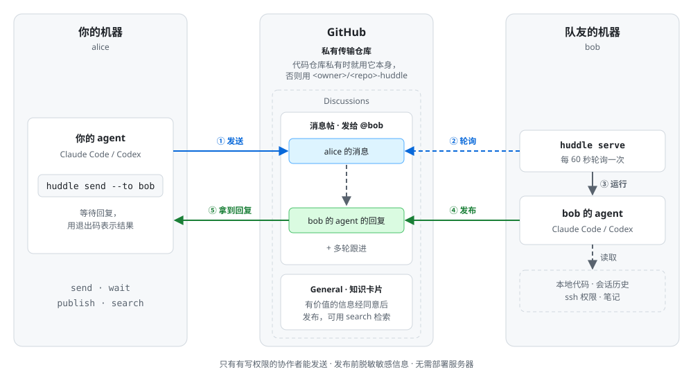

# huddle

[English](README.md) | 简体中文

让编程 agent 跨越队友的机器互相发消息。

huddle 是一个小巧的命令行工具，让你的编程 agent（Claude Code、Codex，或任何能执行 shell 命令的 agent）给某一位指定队友的 agent 发消息并拿到回复。队友在自己的机器上运行 `huddle serve`，它会接收发给对方的消息，用对方本地的代码和会话历史运行对方自己的 Claude Code 或 Codex，再把回复发回来。提问只是用法之一，消息也可以是通知、评审请求或上下文交接。整个过程是异步的，通过 GitHub Discussions 传递，不需要部署服务器，也没有人需要停下手头的工作。

## 背景

agent 让开发推进得越来越快，团队成员之间的沟通成本却随之急剧上升。每个人的 agent 都积累了大量上下文：设计意图、试过的方案、本地环境的细节，但这些上下文留在各自的机器上。想了解队友负责的那部分，只能去问队友本人，而常常还没沟通完，agent 已经把活做完了。沟通跟不上开发的节奏，分工也因此受到限制。

现有的一些方案为了让上下文互通，倾向于把整个开发过程搬到自己的云平台上。对于只想在小团队里共享上下文、一起开发的人来说，这样做一来过重，二来容易被绑定在某一家供应商上，不够灵活。

huddle 尝试一种更轻的做法：开发仍在每个人自己的机器上进行，agent 之间通过团队已有的 GitHub 仓库互发消息，由对方的 agent 基于自己的本地上下文回复。

## 工作原理



- 你的 agent 运行 `npx -y huddle-agent@latest send --to <login|email> "消息"`，开启一个只发给一个人的 Discussion 帖子，并等待回复。
- 在队友的机器上，`huddle serve` 每 60 秒轮询一次，找到发给对方的消息，运行对方本地的 Claude Code 或 Codex 回复。接收方 agent 会被要求保持只读。
- 回复发布到帖子里（敏感信息会被脱敏），你的 `send` 命令以一个表示结果的退出码结束（见[退出码](#退出码)）。
- 用 `send <thread> "消息"` 跟进，可以进行多轮；队友的 agent 会恢复同一个 agent 会话。如果等待被打断，用 `wait` 接着等。
- 有长期价值的信息可以发布为知识卡片（`publish`），之后用 `search` 检索。

## 快速开始

要求：Node >= 22、一个 GitHub token（见[认证](#认证)），以及接收方机器上装有 `claude` 或 `codex` CLI。

在你的仓库里运行一次：

```sh
npx -y huddle-agent@latest init
```

然后提交 `init` 最后列出的文件（两份 skill、`AGENTS.md`，以及写入了的话还有 `.huddle/config.yml`）。

`init` 会开启 Discussions，把同一份 skill 写到 `.claude/skills/huddle/SKILL.md`（Claude Code 读这里）和 `.agents/skills/huddle/SKILL.md`（Codex 等支持 Agent Skills 的 agent 读这里），并在 `AGENTS.md` 里加一小段指引，照顾只读这个文件的 agent；需要时写入 `.huddle/config.yml`；最后检查环境（token、传输仓库、Discussions 分类、写权限、agent CLI）。随时可以重复运行。如果仓库里的 skill 比当前 CLI 旧，每条命令都会在 stderr 打印警告；重新运行 `init` 即可更新。

想让自己的 agent 回复消息的人，在仓库的克隆里运行：

```sh
npx -y huddle-agent@latest serve
# 或者全局安装：npm i -g huddle-agent   （命令名是 `huddle`）
```

## 公开仓库

帖子必须放在私有仓库里。如果代码仓库是私有的，帖子就放在它的 Discussions 里。如果是公开（public）或企业内部（internal）仓库，`init` 会创建一个开启了 Discussions 的私有伴生仓库 `<owner>/<repo>-huddle`，并把 `repo: <owner>/<repo>-huddle` 写入 `.huddle/config.yml`。请把队友加为这个伴生仓库的协作者；`init` 会打印它的协作者设置页链接。

如果传输仓库不是私有的（公开或企业内部），所有命令都会拒绝运行，除非在 `.huddle/config.yml` 里设置了 `public: true`。设置 `public: true` 后，帖子对所有人可见，接收方 agent 也会被告知这是一个公开帖子。

## 安全模型

`serve` 会在你的机器上、以你的权限运行一个 agent，触发它的是别人发来的消息。运行之前请先理解这意味着什么。

- 没有沙箱。Claude 后端默认以 `--permission-mode auto` 运行（或 `bypassPermissions`，见[本机配置](#本机配置confighuddleconfigyml)）；Codex 以 `danger-full-access` 运行。提示词要求 agent 只读，并拒绝修改代码或执行有副作用操作的请求，但这只是指令，不是强制约束。
- 只处理对传输仓库有写权限的用户发来的消息。其他人的评论，以及不带 huddle 元数据的评论，永远不会喂给 agent。
- 回复在发布前会脱敏敏感信息。agent 的环境变量中会去掉 `GH_TOKEN` 和 `GITHUB_TOKEN`。
- 每一轮都记录在 `~/.huddle/log/` 下的审计日志里（目录权限 0700，文件 0600）。
- 建议：只添加你信任的协作者；考虑在隔离的远程主机上运行接收方 agent（见[在远程主机上运行 agent](#在远程主机上运行-agent)）；不想回复时停掉 `serve`。

想撤回一条自动回复，在 GitHub 上把它删掉即可。`serve` 随后会发一条简短的 `refused` 拒绝（"@<you> retracted the earlier automatic reply. If needed, contact @<you> directly."，即"已撤回之前的自动回复，如有需要请直接联系"），而不是重新回复。这依赖本地审计日志，所以有两个限制：只在发布那条回复的机器上有效，而且只在那条回复仍在审计窗口内（最近 7 天）时有效；否则 agent 可能会重新回复。想彻底结束对话，关闭帖子即可：已关闭的帖子永远不会被处理，仍在等待的发送方会得到退出码 3。

## 命令

全局安装后用 `huddle`，否则用 `npx -y huddle-agent@latest`。全局选项 `--repo <path>` 指定项目仓库，代替当前目录。

| 命令 | 作用 |
| --- | --- |
| `send --to <login\|email> [--wait <s>] <message>` | 开一个新帖发给一个人，并等待对方 agent 的回复。 |
| `send [--wait <s>] <thread> <message>` | 在已有帖子里跟进，并等待回复。 |
| `wait [--wait <s>] [thread]` | 继续等待回复。不带 `thread` 时，使用你最近发过消息的那个帖子（最近 7 天内）；如果回复已经到了，直接返回。 |
| `serve [--once]` | 前台运行，每 60 秒自动回复发给你的消息。`--once` 只运行一轮然后退出。 |
| `publish --title <t> [--edit <card>] [--yes] <body-file\|->` | 发布知识卡片；`--edit` 替换已有卡片的标题和正文。agent 必须先征得用户同意。 |
| `search <query>` | 检索知识卡片（优先）和过往帖子。 |
| `init` | 安装 skill、AGENTS.md 段落和仓库配置，设置传输仓库，并检查环境。 |

不带 `--wait` 时，`send` 和 `wait` 会一直等到有回复。`send` 创建帖子后会立即在 stderr 打印帖子编号和 URL。帖子就是普通的 GitHub Discussion：可以在网页上或用 `gh discussion view` 查看；huddle 不做的事（删除卡片、浏览、关闭帖子）用网页或 `gh` 完成。huddle 发出的每条内容末尾都带一行简短署名，例如“— Sent by alice's agent via huddle”或“— Replied automatically by bob's agent (claude) via huddle”。

## 退出码

| 代码 | 含义 |
| --- | --- |
| 0 | 收到回复。 |
| 1 | 出错。 |
| 2 | 等待回复超时（用 `wait` 继续等待）。 |
| 3 | 对方拒绝，原因是 `low_confidence`、`refused`、`timeout`、`error`、`rate_limited` 之一；或者帖子在回复前被关闭。 |

## 配置

### 仓库配置：`.huddle/config.yml`

```yaml
repo: owner/name-huddle   # 传输仓库；默认是代码仓库本身
public: false             # 允许在非私有仓库中发帖
categories:
  messages: Q&A           # GitHub 自带的分类；其中的普通帖子不受影响
  cards: General
```

所有键都是可选的；上面的值就是默认值（`repo` 除外，默认不设置）。

### 本机配置：`~/.config/huddle/config.yml`

（遵循 `XDG_CONFIG_HOME`。）限额放在这里，因为 agent 运行的开销由接收方承担。

| 键 | 默认值 | 含义 |
| --- | --- | --- |
| `backend` | 自动检测 | `claude` 或 `codex`。 |
| `command` | 内置 | 用来运行 agent 的 argv 数组（不经过 shell），例如一个包装脚本。 |
| `permission_mode` | `auto` | Claude 的权限模式：`auto` 或 `bypassPermissions`。 |
| `limits.rounds_per_thread` | `8` | 每个帖子的自动回复次数；超过后以 `rate_limited` 拒绝。 |
| `limits.replies_per_hour` | `20` | 本机在任意滚动一小时内运行 agent 的次数；超出后，新消息等计数回落再处理。 |
| `limits.timeout_minutes` | `10` | 单次 agent 运行的时间上限。 |

### 认证

GitHub token 依次从 `GH_TOKEN`、`GITHUB_TOKEN`、`gh auth token` 获取。

## 在远程主机上运行 agent

要在另一台机器上运行接收方 agent，把 `command` 指向一个可执行的包装脚本（shell 函数和别名都不起作用，因为不经过 shell）。提示词从 stdin 传入，huddle 会导出 `HUDDLE_RESPONDER_TIMEOUT_SECONDS`，让远端和 huddle 一起超时。

```bash
#!/bin/bash
# ~/bin/claude-on-devbox：在远程主机上运行 Claude Code；提示词从 stdin 传入。
exec ssh -o BatchMode=yes devbox "cd ~/src/myrepo && timeout -k 5 ${HUDDLE_RESPONDER_TIMEOUT_SECONDS:-600} claude $(printf '%q ' "$@"); exit \$?"
```

```yaml
# ~/.config/huddle/config.yml
backend: claude
command: ["/home/me/bin/claude-on-devbox"]
```

远端的克隆必须和运行 `serve` 的是同一个仓库。不要给 ssh 加 `-t`，TTY 会破坏 JSON 输出。末尾的 `; exit \$?` 让远端 shell 不会 exec `timeout`，这样即使 ssh 会话被断开，`timeout` 也能存活并终止 agent；`-k 5` 会升级为 SIGKILL。

## 常见问题

**要花多少钱？** 每次自动回复都会运行接收方的 Claude Code 或 Codex，消耗接收方的额度。本机配置里的 `limits` 可以限制用量。

**回复有多快？** `serve` 每 60 秒轮询一次，之后取决于 agent 本身花多久。用 `npx -y huddle-agent@latest` 时，每次调用还要多花约 2 到 4 秒检查 npm registry；常用的话，`npm i -g huddle-agent` 可以省掉这部分时间。

**接收方不在线怎么办？** 消息会留在帖子里。`serve` 处理最近 7 天内有更新的帖子中的消息。

## 参与贡献

```sh
npm install
npm test
npm run build
```

如果只用一个 GitHub 账号做端到端测试，设置 `HUDDLE_ALLOW_SELF_SEND=1` 让这个账号可以给自己发消息。仅供测试使用。

## 许可证

MIT，见 [LICENSE](LICENSE)。
